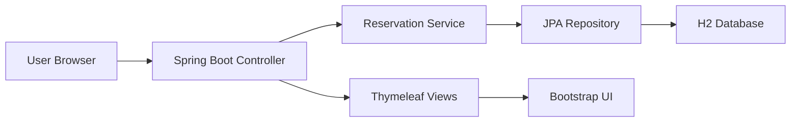

# RailEase — Smart Rail Reservation Platform

A modern Java web application for booking, managing, and canceling train reservations. The project uses a browser-based interface so users can sign in, search reservations, create bookings, and cancel tickets from a clean dashboard.

[](https://www.oracle.com/java/)
[](https://spring.io/projects/spring-boot)
[](https://www.thymeleaf.org/)
[](https://getbootstrap.com/)
[](https://www.h2database.com/)
[](https://maven.apache.org/)

## Overview

RailEase provides a simple and clear reservation workflow:

- Login to the reservation dashboard
- Search and manage bookings
- Book a journey with generated PNR
- View all saved reservations in a searchable table
- Cancel an existing reservation
- Store data locally in an embedded database for easy setup

## Frontend and interface technology

This project uses a web frontend instead of Swing:

- Java + Spring Boot for the backend
- Thymeleaf templates for rendering pages
- HTML + CSS + Bootstrap for the interface design
- Dynamic tables and form handling for booking and search operations

So the user interface is browser-based and modern, not a desktop Swing application.

## Architecture



## Features

- Secure login with username/password validation
- Auto-fill train name based on train number
- Booking validation for required fields and dates
- PNR generation for each reservation
- Searchable reservation overview table
- Reservation cancellation workflow
- Embedded H2 database for quick local setup
- Easy deployment with Maven and Spring Boot

## Tech stack

- Java 17
- Spring Boot 3.3.x
- Spring Web MVC
- Thymeleaf
- Bootstrap 5
- Spring Data JPA
- H2 Database
- Maven

## Project structure

```text
Online-Train-Reservation-System/
├── pom.xml
├── README.md
├── .gitignore
├── src/
│   └── main/
│       ├── java/
│       │   └── com/
│       │       └── railway/
│       │           ├── config/
│       │           ├── controller/
│       │           ├── model/
│       │           ├── repository/
│       │           ├── service/
│       │           └── RailwayReservationWebApplication.java
│       └── resources/
│           ├── application.properties
│           └── templates/
│               ├── login.html
│               └── dashboard.html
└── target/                     # build output
```

## Demo credentials

| Username | Password |
| --- | --- |
| `admin` | `admin123` |
| `traveler` | `welcome123` |

## Quick start

### Prerequisites

- Java 17 or newer
- Maven 3.x
- Git

### Run the project

```bash
cd Online-Train-Reservation-System
mvn clean install
mvn spring-boot:run
```

Then open:

```text
http://localhost:8080/login
```

## How it works

1. The app starts with Spring Boot.
2. A browser loads the login page.
3. After successful login, the dashboard opens.
4. Users can create new bookings and view reservation records.
5. Data is stored in an embedded H2 database.
6. Search and cancellation operations are handled in the backend service layer.

## Database behavior

The application uses an H2 in-memory database for local development and testing. This keeps the project light and easy to run without installing a separate database server.

## Future enhancements

- User registration page
- Admin panel for train management
- PDF/CSV export for bookings
- Role-based authorization
- Payment and ticket status module
- Production database migration to PostgreSQL/MySQL

## License

This project is intended for learning and demonstration purposes.

---

Built with Java, Spring Boot, Thymeleaf, and Bootstrap for a modern rail booking experience.
