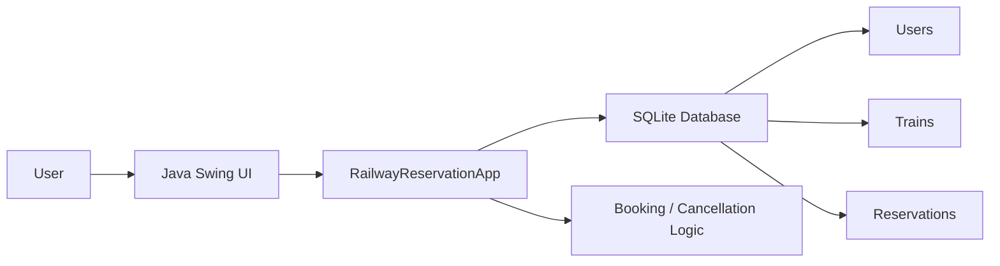
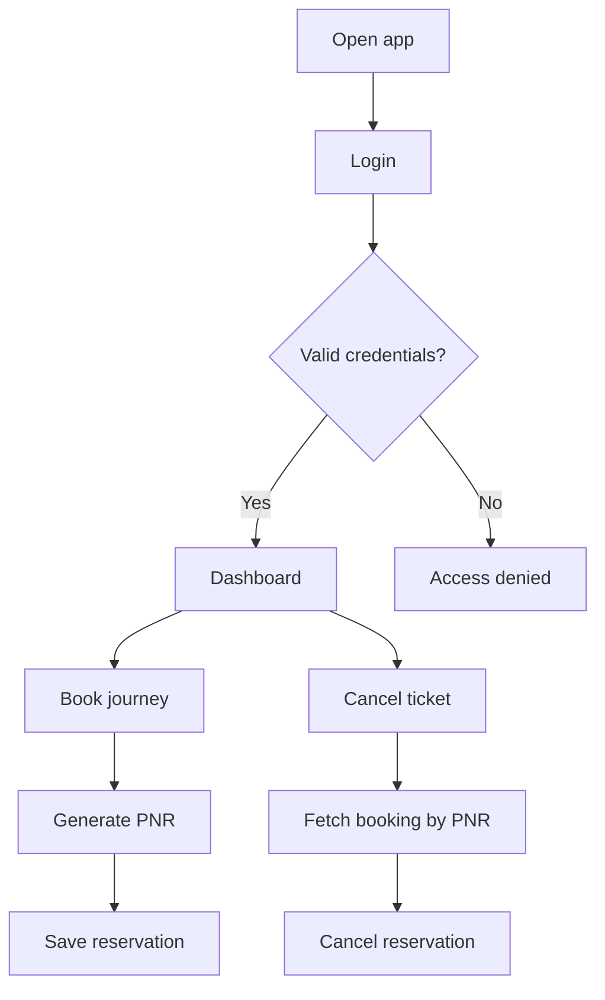

# RailEase — Smart Rail Reservation Platform

A polished Java Swing desktop application for booking, managing, and canceling train reservations with a local SQLite database. Built for clarity, reliability, and quick local setup.

[](https://www.oracle.com/java/)
[](https://maven.apache.org/)
[](https://www.sqlite.org/)

## Overview

RailEase gives a traveler a clean reservation workflow:

- Sign in to the desk dashboard
- Search and validate train information
- Book a trip and generate a unique PNR
- Review reservation details before cancellation
- Persist data locally using SQLite

This project is designed as a practical Java desktop booking app with a visually friendly interface and fast local operations.

## Architecture



## User flow



## Features

- Secure login with SQLite-backed credential validation
- Train number lookup for automatic train name population
- Booking form with validation for names, dates, and travel classes
- Unique PNR generation for each reservation
- Reservation lookup and cancel workflow
- Automatic database creation for first-time setup
- Local-first architecture with no cloud dependency

## Tech stack

- Java 8+
- Maven
- SQLite JDBC driver
- Swing UI toolkit

## Project structure

```text
Online-Train-Reservation-System/
├── pom.xml
├── README.md
├── .gitignore
├── railease.db                # created automatically at runtime
├── src/
│   └── main/
│       └── java/
│           └── com/
│               └── railway/
│                   └── RailwayReservationApp.java
└── target/                    # generated after Maven build
```

## How it works

1. The application starts in `RailwayReservationApp.main()`.
2. The Swing UI loads the login screen.
3. On successful sign-in, the dashboard opens.
4. Booking entries are validated and saved to SQLite.
5. Reservation details are queried by PNR before cancellation.
6. The database is created automatically on first run if it does not exist.

## Demo credentials

| Username | Password |
| --- | --- |
| `admin` | `admin123` |
| `traveler` | `welcome123` |

## Quick start

### Prerequisites

- Java 8 or newer
- Maven 3.9+
- Git

### Windows PowerShell

```powershell
cd path\to\Online-Train-Reservation-System
mvn clean compile exec:java
```

### macOS / Linux

```bash
cd /path/to/Online-Train-Reservation-System
mvn clean compile exec:java
```

### If you want a one-time Maven setup in PowerShell

```powershell
cd "C:\path\to\Online-Train-Reservation-System"
$env:Path = "$PWD\.tools\apache-maven-3.9.16\bin;$env:Path"
mvn clean compile exec:java
```

### Run directly from repository root

```bash
mvn clean package
java -cp target/classes:$(find ~/.m2/repository -name 'sqlite-jdbc-*.jar' | head -n 1) com.railway.RailwayReservationApp
```

## Operating guide

### 1. Launch the app
Run the Maven command shown above. The app opens with a login screen.

### 2. Sign in
Use one of the demo credentials listed above.

### 3. Book a journey
On the dashboard:

- Enter passenger name
- Add train number
- The train name auto-populates if recognized
- Select a class
- Enter journey date
- Fill source and destination stations
- Click `Confirm booking`

### 4. Confirm details
A confirmation window appears with the generated PNR.

### 5. Cancel a reservation
- Go to the cancellation tab
- Enter the PNR
- Fetch the booking
- Review the details
- Click `Cancel this booking`

## Database behavior

The app creates and uses a local SQLite database named `railease.db` in the project root. It contains:

- `users` — login credentials
- `trains` — train numbers and names
- `reservations` — PNRs and booking data

The application uses prepared statements to reduce injection risk and keep database queries consistent.

## Reliability improvements applied

- Database initialization is handled automatically
- Demo data is inserted only when content is missing
- Input validation is enforced before booking
- Dates are parsed using `dd-MM-yyyy` validation
- Queries use `PreparedStatement` for safer execution
- Reservation actions are guarded against invalid or empty values

## Future enhancements

- Add user registration and role-based access
- Introduce admin panel for train management
- Add CSV export for bookings
- Add audit trail for cancellations
- Add reservations by station and date filters
- Convert to a web version using Spring Boot later

## License

This project is currently distributed as a learning/demo application. You may adapt and extend it for personal or educational use.

## Notes

This repository is intentionally simple, local, and fast to run. It is a strong starting point for a desktop train reservation system and can be extended into a more complete production-grade application.

---

Built for a modern, clean local booking experience.
